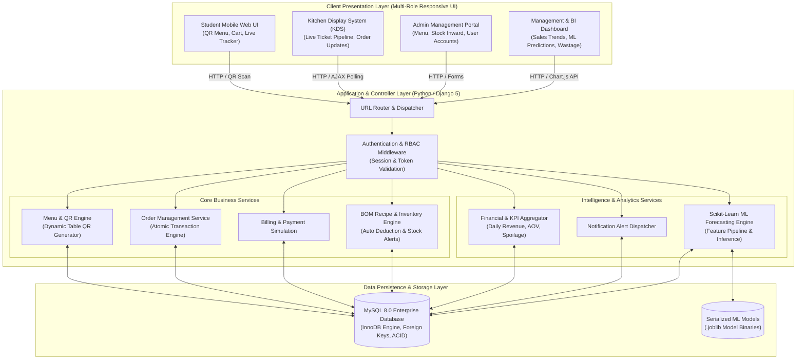
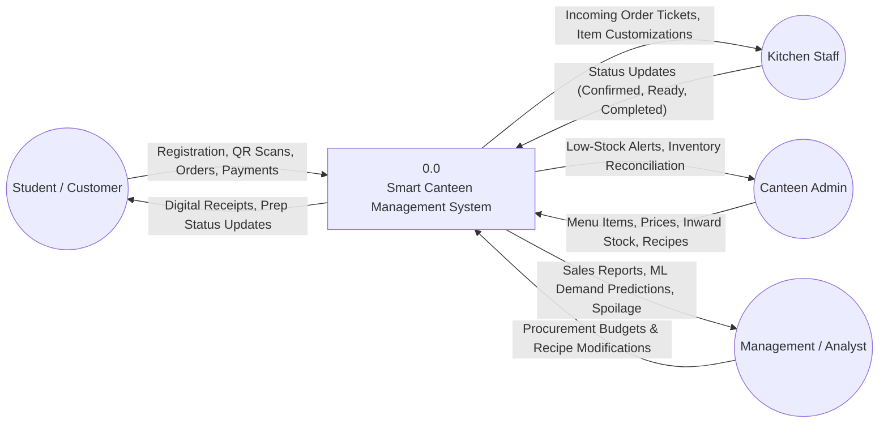
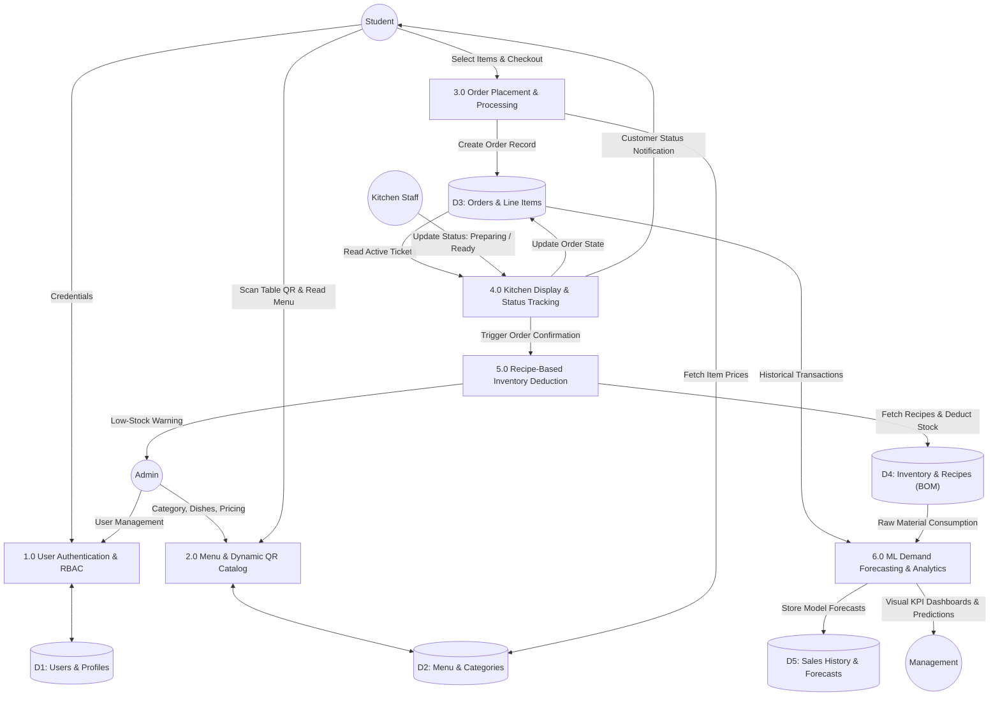
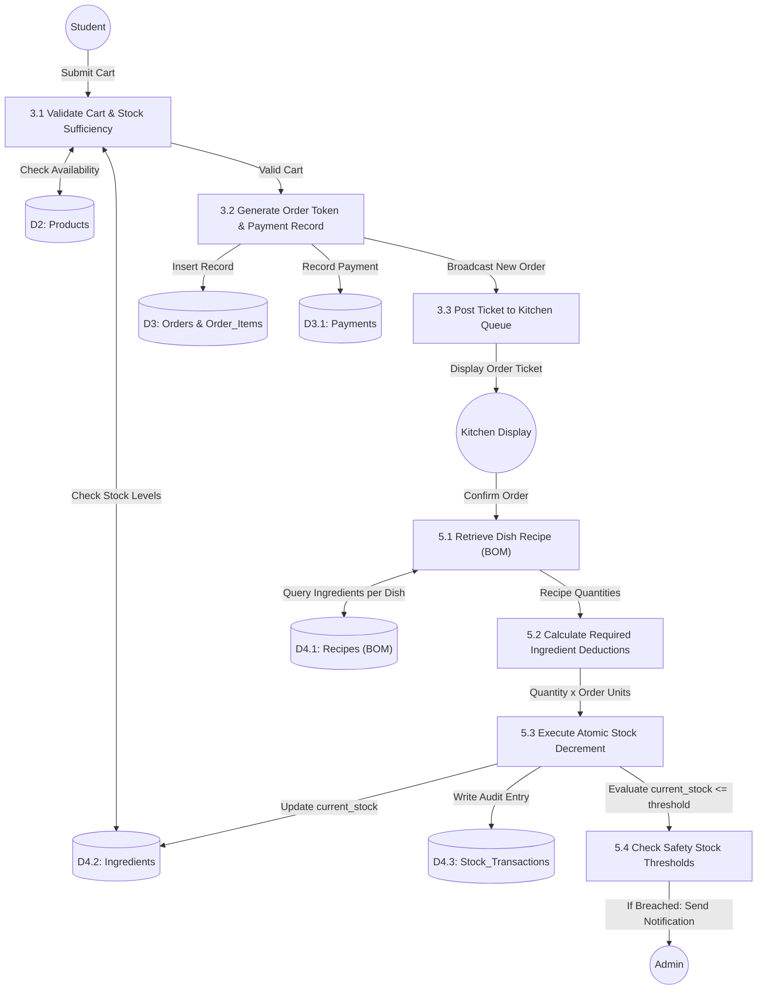
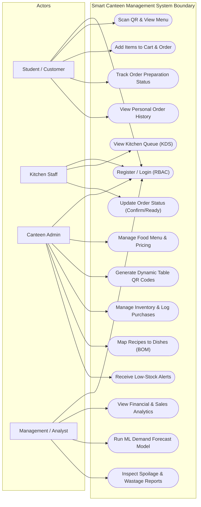
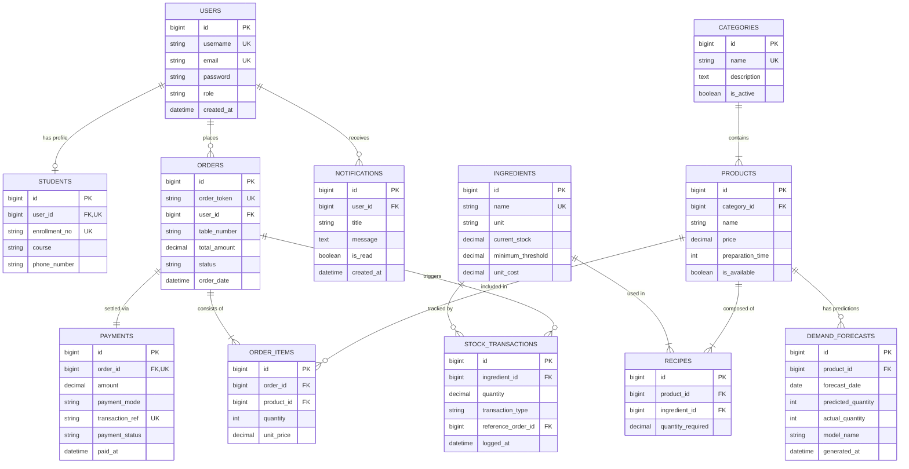
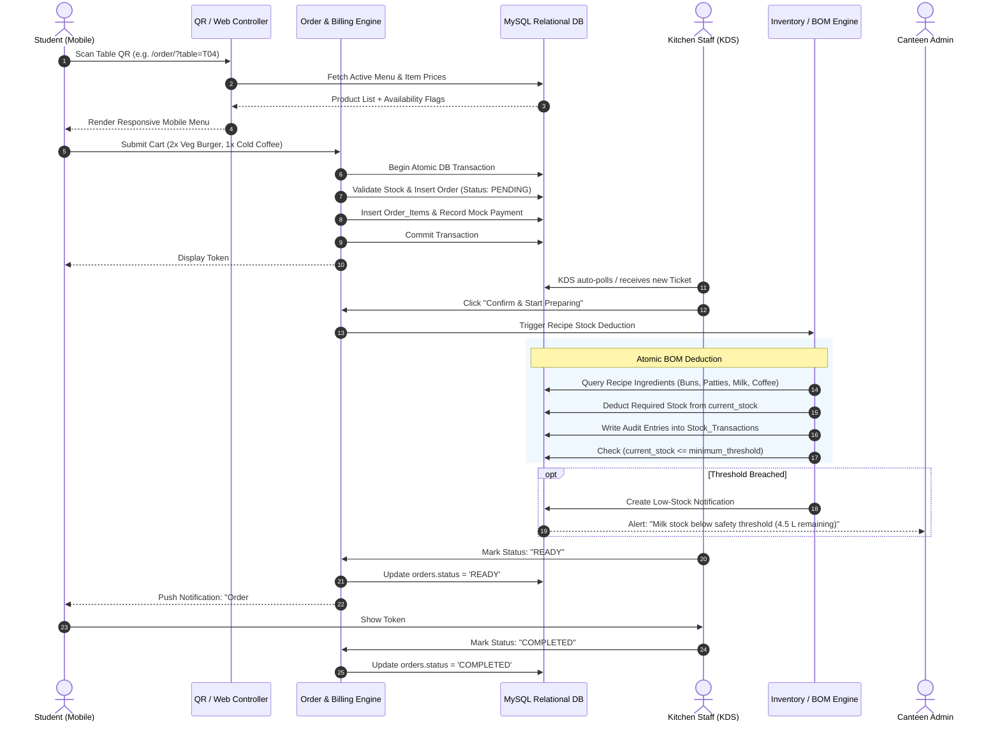
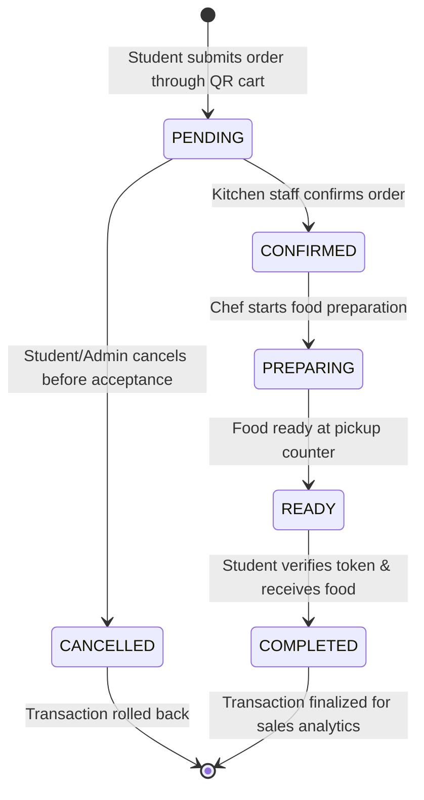
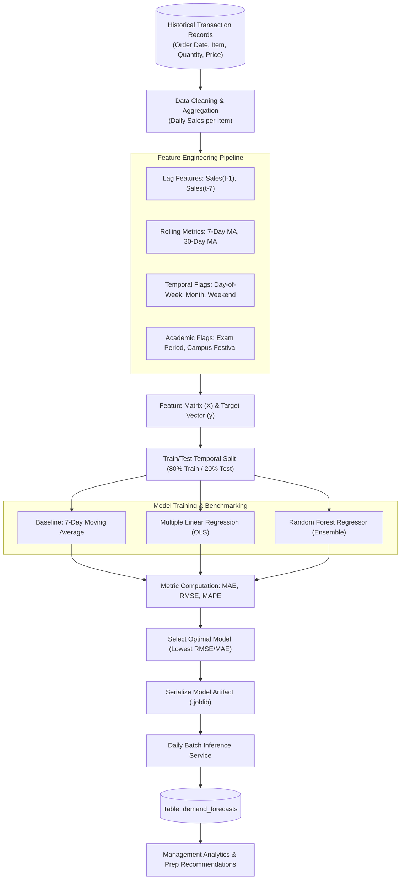

# SYSTEM DESIGN & ARCHITECTURE DOCUMENT (HLD & LLD)
## Smart Canteen Management System (SCMS)
### IPU MCA 269 Minor Project — System Design Specifications (35% Evaluation Weightage)

---

## 1. High-Level Design (HLD) Architecture

The Smart Canteen Management System utilizes a **Modular Monolithic Architecture** with Model-View-Template (MVT) design patterns, complemented by asynchronous RESTful endpoints.

---

## 2. Data Flow Diagrams (DFD)

### 2.1 DFD Level 0 (Context Diagram)
The Level 0 DFD illustrates external entities interacting with the boundary of the Smart Canteen Management System.

---

### 2.2 DFD Level 1 (Decomposition Diagram)
Decomposes the system into its primary subsystems, data flows, and relational data stores.

---

### 2.3 DFD Level 2 (Order Placement & Inventory Deduction Subsystem)
Highlights the atomic transactional process bridging order confirmation and raw stock consumption.

---

## 3. UML Use-Case Diagram

---

## 4. Entity-Relationship (ER) Diagram

Represents the complete 12-table relational schema using Crow's Foot cardinality notation.

---

## 5. Sequence Diagram: Contactless QR Order to Kitchen Fulfilment

---

## 6. Order Lifecycle State Machine Diagram

---

## 7. Machine Learning Demand Forecasting Pipeline

---

*System Design specifications verified and ready for IPU MCA 269 Minor Project evaluation.*

