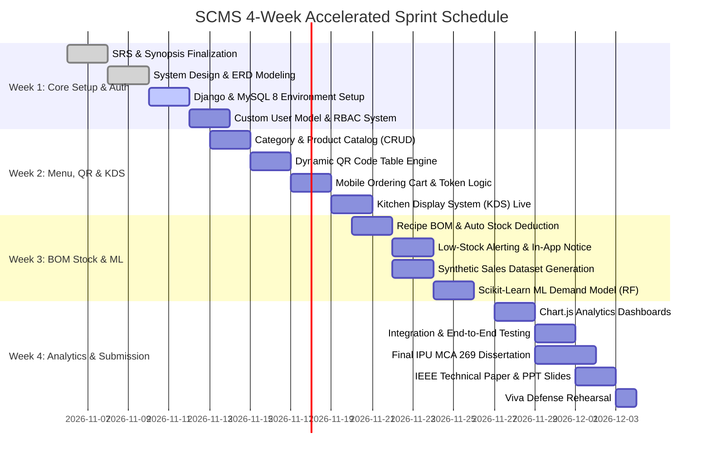

# TEAM RESPONSIBILITY MATRIX & 4-WEEK ACCELERATED SPRINT PLAN
## Smart Canteen Management System (SCMS)
### Tailored for IPU MCA 269 Minor Project (4 Members • 4-Week Fast-Track)

---

## 1. Team Organization & Viva Responsibility Matrix

To achieve maximum marks under the IPU MCA 269 evaluation scheme (which tests individual contribution, system comprehension, and software engineering rigor), technical tasks are cleanly divided across 4 team members while retaining collective understanding.

```
┌────────────────────────────────────────────────────────────────────────┐
│                   SCMS TEAM DIVISION OF RESPONSIBILITIES               │
├────────────────────┬────────────────────┬──────────────────────────────┤
│ Team Member        │ Primary Domain     │ Core Modules & Viva Focus    │
├────────────────────┼────────────────────┼──────────────────────────────┤
│ Member 1           │ Backend Lead &     │ Django 5 Setup, Custom User, │
│                    │ System Architect   │ RBAC, Atomic Order Pipeline, │
│                    │                    │ REST APIs, Error Handling    │
├────────────────────┼────────────────────┼──────────────────────────────┤
│ Member 2           │ Frontend &         │ Bootstrap 5, Mobile QR Cart, │
│                    │ UI/UX Engineer     │ Kitchen Display System (KDS),│
│                    │                    │ Admin & Management UI,       │
│                    │                    │ Chart.js Visualizations      │
├────────────────────┼────────────────────┼──────────────────────────────┤
│ Member 3           │ Database &         │ MySQL 8 Schema, InnoDB,      │
│                    │ Inventory Engineer │ Recipe BOM Mapping, Atomic   │
│                    │                    │ Stock Deduction, Audit Log,  │
│                    │                    │ Mock Payment Transactions    │
├────────────────────┼────────────────────┼──────────────────────────────┤
│ Member 4           │ ML & Data          │ Sales Data Pipeline, Feature │
│                    │ Analytics Engineer │ Engineering, Scikit-learn    │
│                    │                    │ Regressors (LinReg / RF),    │
│                    │                    │ MAE/RMSE Metrics, Synopsis,  │
│                    │                    │ Project Report & Paper       │
└────────────────────┴────────────────────┴──────────────────────────────┘
```

---

## 2. 4-Week Accelerated Sprint Roadmap



---

## 3. Week-by-Week Action Items & Deliverables

### Week 1: Requirements Engineering, System Modeling & Core Scaffolding
- **Member 1 (Backend):**
  - Initialize Django 5.x project repository with modular structure (`apps/authentication`, `apps/menu`, `apps/orders`, `apps/inventory`, `apps/analytics`).
  - Implement custom `User` model inheriting `AbstractUser` with role fields: `STUDENT`, `ADMIN`, `KITCHEN`, `MANAGEMENT`.
  - Author role validation decorators (`@role_required('ADMIN')`).
- **Member 2 (Frontend):**
  - Create base Jinja/Django template structure with Bootstrap 5.3 CDN, responsive navigation, responsive sidebar, and toast notifications.
  - Implement clean modern login and student registration views.
- **Member 3 (Database):**
  - Set up local MySQL 8.0 database `smart_canteen_db` with UTF-8 character encoding.
  - Verify relational table creation, primary keys, foreign keys, and indexes via Django migrations.
  - Create database migration scripts and seed initial superuser and role accounts.
- **Member 4 (ML & Docs):**
  - Author formal Project Synopsis and IEEE 830 compliant SRS document.
  - Generate DFD Level 0, 1, 2 and Crow's Foot ER Diagrams.
  - Submit synopsis to the MCA Minor Project Coordinator for formal guide approval.

### Week 2: Menu Management, QR Code Engine, Cart & Kitchen KDS
- **Member 1 (Backend):**
  - Implement order dispatch endpoint with atomic database transaction (`django.db.transaction.atomic`).
  - Build order token generation routine (`SC-0001` through `SC-9999`) with timestamped validation.
- **Member 2 (Frontend):**
  - Build responsive mobile student menu screen with search, category filtering, and sticky bottom cart bar.
  - Develop Kitchen Display System (KDS) board with high-contrast color cards (`Pending` = Yellow, `Preparing` = Blue, `Ready` = Green).
- **Member 3 (Database):**
  - Seed product catalog with 25+ realistic cafeteria dishes across 4 categories (Meals, Fast Food, Beverages, Desserts).
  - Implement table routing (`/order/?table=T01` to `/order/?table=T15`).
- **Member 4 (ML & Docs):**
  - Implement Python `qrcode` utility generating downloadable SVG/PNG table placards.
  - Compile Section 5 & 6 (System Architecture and HLD) for the final project report.

### Week 3: Bill of Materials (BOM), Inventory Automation & ML Engine
- **Member 1 (Backend):**
  - Wire atomic stock decrement handler executed when kitchen staff transitions an order to `CONFIRMED`.
  - Build in-app notification engine with alert triggers for items breaching safety thresholds.
- **Member 2 (Frontend):**
  - Build Admin Inventory Dashboard with live stock meters, unit costs, and threshold warning badges.
  - Build modal form for easy ingredient mapping and recipe formulation.
- **Member 3 (Database):**
  - Create ingredient catalog (Rice, Flour, Potatoes, Oil, Milk, Paneer, Spices, Tea, Coffee).
  - Populate `recipes` table with multi-ingredient mappings for every dish on the menu.
  - Create `stock_transactions` audit logging for inward purchases, sales deductions, and wastage.
- **Member 4 (ML & Analytics):**
  - Generate a 1-year synthetic cafeteria sales dataset (365 days, 15,000+ line items) with realistic seasonality, weekend dips, and exam-week spikes.
  - Train Scikit-learn Linear Regression and Random Forest Regressor models predicting next-day quantity per dish.
  - Calculate empirical validation metrics: MAE, RMSE, and MAPE. Benchmark against a 7-day Moving Average baseline. Save models using `joblib`.

### Week 4: Management Analytics, Integration Testing & Final Submission
- **Member 1 (Backend):**
  - Expose JSON analytics endpoints for Chart.js (daily gross sales, sales by category, peak ordering hour histogram).
  - Conduct full system security testing (SQL injection immunity, CSRF validation, session tampering checks).
- **Member 2 (Frontend):**
  - Integrate interactive Chart.js graphs into Management Portal with date-range filters.
  - Conduct mobile browser UI testing across iOS Safari and Android Chrome.
- **Member 3 (Database):**
  - Run database performance checks, verify zero orphan records during order cancellations, ensure transactional rollback accuracy.
  - Prepare MySQL backup dump (`smart_canteen_backup.sql`) for easy evaluation reproduction.
- **Member 4 (ML & Docs):**
  - Compile the complete 60–80 page **IPU MCA 269 Minor Project Report** (Chapters 1–11).
  - Write an **IEEE-formatted Technical Research Paper** titled: *"An Intelligent QR-Based Ordering and BOM Inventory System with Demand Forecasting for University Cafeterias"*.
  - Prepare a 20-slide presentation deck (PPT) and coordinate a full team viva dry-run.

---

## 4. IPU Evaluation Rubric Checklist & Target Scores

| Evaluation Component | Weightage | What Examiners Check | SCMS Implementation Evidence |
| :--- | :---: | :--- | :--- |
| **Requirements Analysis** | **45%** | Problem identification, feasibility study, stakeholders, IEEE 830 SRS, use cases. | Comprehensive problem formulation, real-world canteen bottleneck study, complete 14 Functional Requirements, NFRs, and user role separation. |
| **System Designing** | **35%** | HLD, LLD, DFD Levels 0/1/2, ER diagram with normalization (3NF), UML sequence/state diagrams, DB schema. | Modular monolithic MVT architecture, 12 normalized InnoDB tables, complete DFD hierarchy, BOM recipe relation, and ML pipeline design. |
| **Implementation & Presentation** | **10%** | Working live software, code quality, responsive design, transactional accuracy, viva answers. | Working Django + MySQL web platform, mobile QR scan, live KDS, atomic stock deduction, and real-time Chart.js dashboards. |
| **Technical Paper & Documentation** | **10%** | Standard dissertation formatting, citations, IEEE technical manuscript, slide deck quality. | Bound project report strictly formatted to IPU norms, 6-page IEEE paper, and structured presentation slide deck. |

---

*Sprint Plan approved for active execution.*

